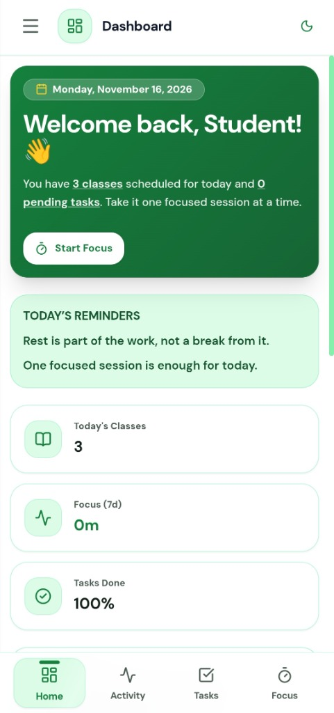
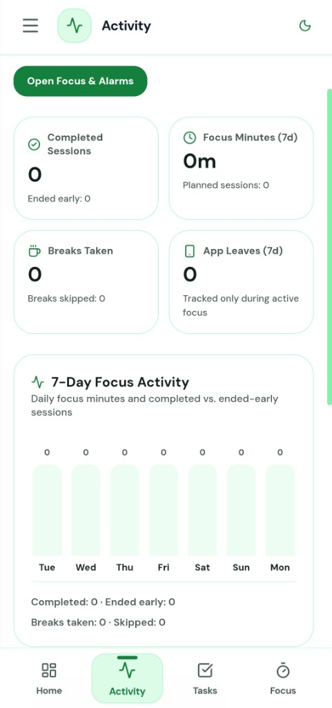
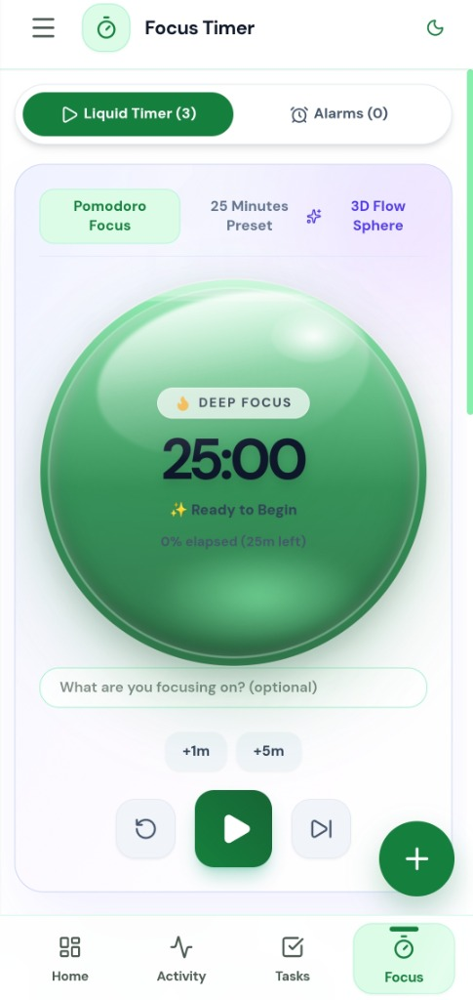
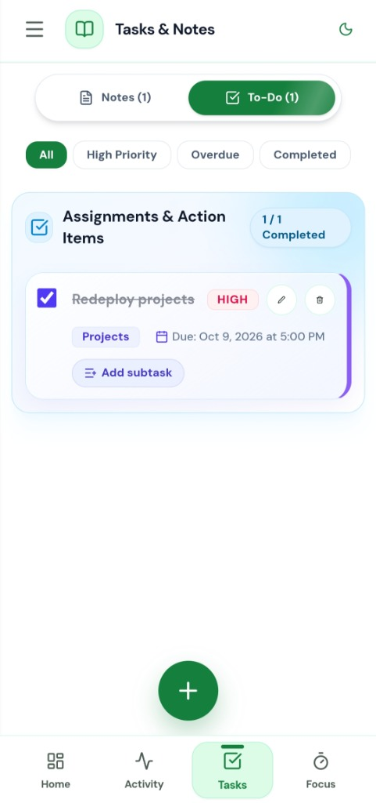

# Digital Wellness Project — Submission Draft & Templates

> **Important:** Do not invent fake interviews or fake usability test numbers. The **Problem Statement**, **Requirements**, **Revision Record**, and **Presentation Outline** below are ready to use based on the actual app and the real feedback your friends gave you. Fill in the **Interview Summary**, **Hand-Drawn Wireframes**, and **Usability Test Results** using real responses (even if from a smaller group of 2–3 friends, state the exact sample size honestly).

---

## 1. Problem Statement & Requirements

### Problem Statement
University students often check their phones during planned study sessions and scroll late into the night. Existing productivity apps commonly rely on streaks, GPA targets, and red warning banners, which can increase anxiety or guilt rather than supporting calm, sustainable focus. There is a need for an offline-first study planner that helps students notice phone-drift without shaming them, enforces restorative breaks, and supports a consistent bedtime wind-down routine.

### Existing Alternatives & Gap
- **Standard Pomodoro / study timers:** Track countdowns but do not record how often a user leaves the app, and often allow skipping straight into the next work block without a break screen.
- **Academic planners (e.g., original `studyzflow`):** Focus on streaks, GPA targets, and alert-style attendance warnings, which add pressure rather than supporting digital wellness.
- **Gap addressed:** An offline, privacy-preserving planner that tracks only session timestamps and background leave counts on-device, enforces breaks with a calm prompt, offers daily non-shaming reminders, and includes a bedtime wind-down preset.

### Functional & Non-Functional Requirements
1. **Focus sessions with enforced breaks:** Start Pomodoro or custom focus sessions; when a work block ends, display a full-screen break screen (`Short Break (5 min)`, or `Long Break (15 min)` after every 4th work block) with a countdown, calm prompt (*"Stretch, drink water, leave your phone face-down."*), and a keyboard-operable **Skip break** button that records skips.
2. **Phone-drift counter:** Count background transitions (`visibilitychange` on web, `@capacitor/app` `appStateChange` on Android) only while a focus session is running; store only `startedAt` and `leaveCount` on the device; show a neutral summary at session end.
3. **Bedtime wind-down alarm:** Provide a one-tap **Bedtime wind-down** preset (`"Time to wind down. Put study and scrolling away."`, repeating daily).
4. **Non-shaming dashboard:** Show a 7-day **Weekly Reflection** (Planned Focus Sessions, Completed Focus Sessions, Total Focus Minutes, Breaks Taken), a **Live Session Card**, **Today's reminders** (2 calm daily quotes), and plain-wording attendance info without streaks, GPA, or scolding.
5. **Privacy & accessibility:** Store all data on-device (`ENABLE_CLOUD_SYNC = false`), remove AI/cloud dependencies (`@google/genai`), use a high-contrast green-and-white palette (`>= 4.5:1`), support `prefers-reduced-motion`, `aria-label`s, and visible green `:focus-visible` rings.

---

## 2. Revision Record (Before & After)

| # | Finding / Feedback | Before | After |
|---|---|---|---|
| **1** | **Friends requested encouraging quotes** (*"it's better to have some quotes"*) | Dashboard had no calming reminders—only a welcome banner, streak counter, and GPA card. | Added `dailyQuotes.ts` and the **Today's reminders** card on the Dashboard showing 2 calm, non-rotating daily quotes in `#14532D` on `#DCFCE7`. |
| **2** | **Friends reported alarms sometimes did not ring** | Alarms relied on basic scheduling without a dedicated wind-down preset, and cloud/sync clutter competed for attention. | Added a one-tap **Bedtime wind-down** daily alarm preset using `scheduleAlarmNotification(..., repeat: 'daily')`. *(Note in report: background alarm reliability on Android also depends on battery-optimization / exact-alarm OS permissions, which should be tested on-device.)* |
| **3** | **Stressful gamification & academic ERP clutter** (Author/user review: Attendance tracking diluted the digital wellness focus) | App included Study Streak, Target GPA, Attendance Hub (75% criteria, extra classes), and red/amber warning banners. | Removed Streak, Target GPA, and the entire Attendance section; replaced Attendance with the **Activity** tab (7-day focus minutes & completed vs. ended-early charts, phone-drift trend, post-session mood check-in, and Bedtime Wind-Down Report). |
| **4** | **Dashboard & header clutter + sample data** (Author/user review) | Hero had 3 extra buttons + Attendance pill; header showed `Tab Sync` / `Local Ready`; new installs pre-loaded sample timers. | Kept only **Start Focus** in the hero, replaced sync labels with `"Data stored on this device"`, added a **Live Session Card**, and enabled clean seed mode (`ENABLE_DEV_SAMPLE_DATA = false`). |
| **5** | **UI contrast bug on Tasks & Notes sliding pill** (Author/user testing caught invisible `To-Do (0)` tab) | After removing legacy orange/indigo CSS classes, `.liquid-orange-pill` lost its background, leaving white `To-Do (0)` text invisible on a white background. | Replaced `.liquid-orange-pill` and active filter pills in `NotesAndTasks.tsx` with `bg-[#15803D]` so active tabs and labels maintain >= 4.5:1 contrast. |
| **6** | **Uncontrolled focus-to-focus flow & visual clutter** | Finishing a timer logged a session without enforcing a break or counting app leaves; UI used bright indigo/orange gradients. | Added an enforced full-screen break screen (`shortBreak` / `longBreak`), neutral leave-count summary, optional focus intention, "End early" option, and a calm green-and-white theme (`#FFFFFF` / `#0F1F17`, `#15803D`). |

### Final Prototype Screenshots (After Revisions)

| Dashboard | Wellness Activity | Focus Timer | Tasks & Notes |
|---|---|---|---|
|  |  |  |  |

---

## 3. Hand-Drawn Wireframe Guide (Draw on Paper & Photograph)

Sketch these 4 screens on paper with a pen/pencil, label the buttons, and take clear photos for your report:
1. **Screen 1 — Dashboard:** Header (`+ New Task`, `Data stored on this device`), Hero (`Welcome back`, `Start Focus` button), `Today's reminders` box (2 lines of text), 3-card Stat Row (`Today's Classes`, `Focus (7d)`, `Tasks Done`), `Live Session` card, `Weekly Reflection` (4 boxes or empty state).
2. **Screen 2 — Activity Tab:** 4 summary cards (`Completed Sessions`, `Focus Minutes (7d)`, `Breaks Taken`, `App Leaves (7d)`), 7-Day Focus Activity bar chart, Phone-Drift & Reflections card, and Bedtime Wind-Down Report (`Wound down on time` / `Stayed up late` + 7-day strip).
3. **Screen 3 — Focus Timer & Enforced Break Screen:** Preset pills (`Pomodoro Focus`, `Short Break (5 min)`, `Long Break (15 min)`), optional intention input, circular timer orb, and full-screen break overlay (*"Stretch, drink water, leave your phone face-down."* + `Calm`/`Neutral`/`Distracted` + `Skip break`).
4. **Screen 4 — Alarms (Bedtime Wind-down):** `Bedtime wind-down` preset button, label input, time picker (`22:00`), `Daily` repeat selector, and saved alarm list.

---

## 4. Short Interview & Usability Test Templates (Run with 2–5 Friends/Classmates)

### A. 3-Question Pre-Design / Habit Interview (Ask 2–5 People, Anonymize as P1, P2, ...)
1. *When you plan a study session, how often do you end up checking your phone, and what usually triggers it?*
2. *What tools or alarms do you currently use for studying or winding down at night, and where do they fail you?*
3. *How do streak counters or warning messages in study apps make you feel?*

*(Include your friends' real earlier feedback here too—e.g., "P1 & P2 tested an earlier build and reported that alarms sometimes did not ring and asked for calm quotes.")*

### B. 3-Task Usability Test (Record Pass/Fail, Confusion Points, & Feedback)
Give each participant the app (web preview or Android) and ask them to complete:
1. **Task 1 (Focus & Leave Count):** Start a 25-minute (or 1-minute custom) focus session, switch away from the app once, return, and check the leave count.
2. **Task 2 (Enforced Break):** Let the session finish, read the break screen, and skip the break using the button or keyboard (`Escape`/`Enter`).
3. **Task 3 (Bedtime Alarm & Reflection):** Open **Alarms**, create a **Bedtime wind-down** daily alarm, then return to **Dashboard** and read the **Weekly Reflection** card.

| Participant | Task 1 (Focus & Leave) | Task 2 (Break & Skip) | Task 3 (Bedtime & Reflection) | Confusion / Feedback |
|---|---|---|---|---|
| P1 | | | | |
| P2 | | | | |
| P3 | | | | |

---

## 5. Presentation Outline (6–8 Slides)

1. **Title:** Digital Wellness Project — Calm Study Planner (built on `studyzflow` by Dineswarkumar)
2. **Problem:** Phone-drift during study sessions, late-night scrolling, and anxiety from streak/GPA-driven apps.
3. **User Feedback & Requirements:** Early friend feedback (alarms missing, request for calm quotes) + 5 core requirements.
4. **Wireframes & Design Decisions:** Photos of hand-drawn wireframes + green-and-white calm redesign.
5. **Key Features Demo:** Enforced break screen, phone-drift leave counter, daily `Today's reminders` quotes, bedtime wind-down alarm, 7-day Weekly Reflection.
6. **Usability Testing & Revisions:** Summary table of real user tasks, confusion points, and before/after revisions.
7. **Privacy, Accessibility & Verification:** On-device storage only, `aria-label`/keyboard focus rings, 33 passing unit tests (`vitest`), lint & build passing.
8. **Acknowledgments & Limitations:** Credit to Dineswarkumar (`studyzflow`), AI coding assistance disclosed per guidelines, and limitations (e.g., Android exact-alarm OS permissions, sample size).
